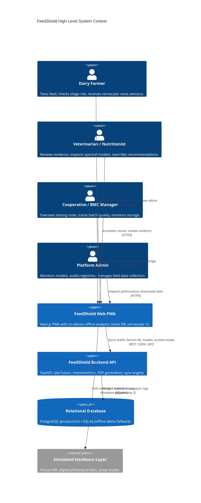
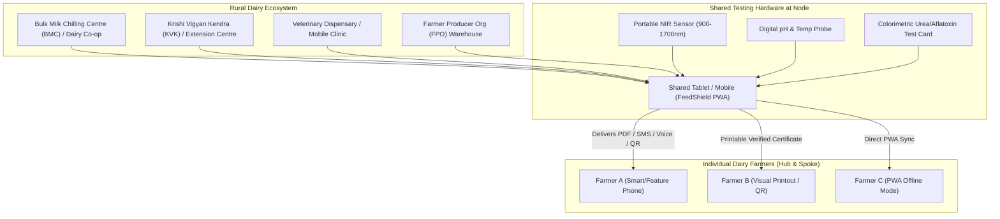
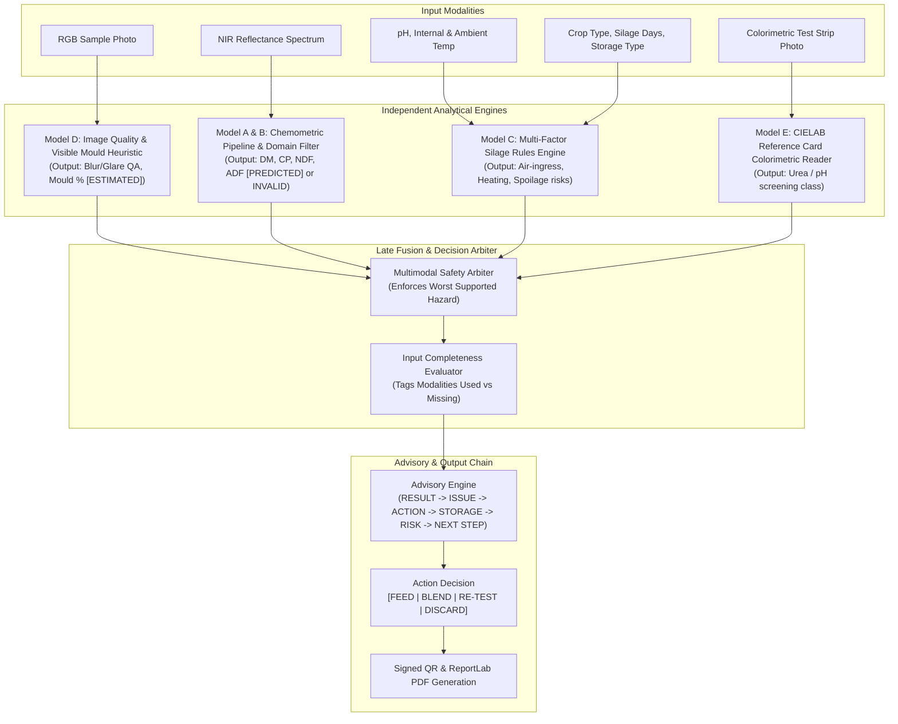
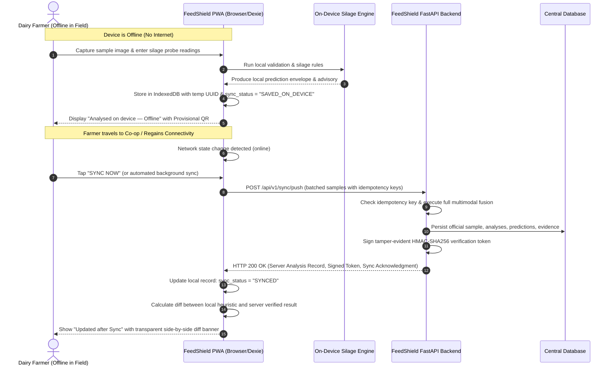

# FeedShield System Architecture

This document outlines the system topology, deployment paradigms, operational workflows, and data synchronization patterns for FeedShield.

---

## 1. System Context Diagram

---

## 2. Shared Test-Node Deployment Model

FeedShield recognises that smallholder Indian dairy farmers rarely own ₹50,000+ laboratory instruments. Testing services are deployed through **Shared Testing Nodes**:

---

## 3. Multimodal Late Fusion Architecture

FeedShield employs **Late Fusion** where each sensory modality is evaluated by a specialized model or rule-set, followed by a deterministic safety arbiter enforcing the **Worst Supported Hazard** principle.

---

## 4. Offline-First Synchronization Sequence

