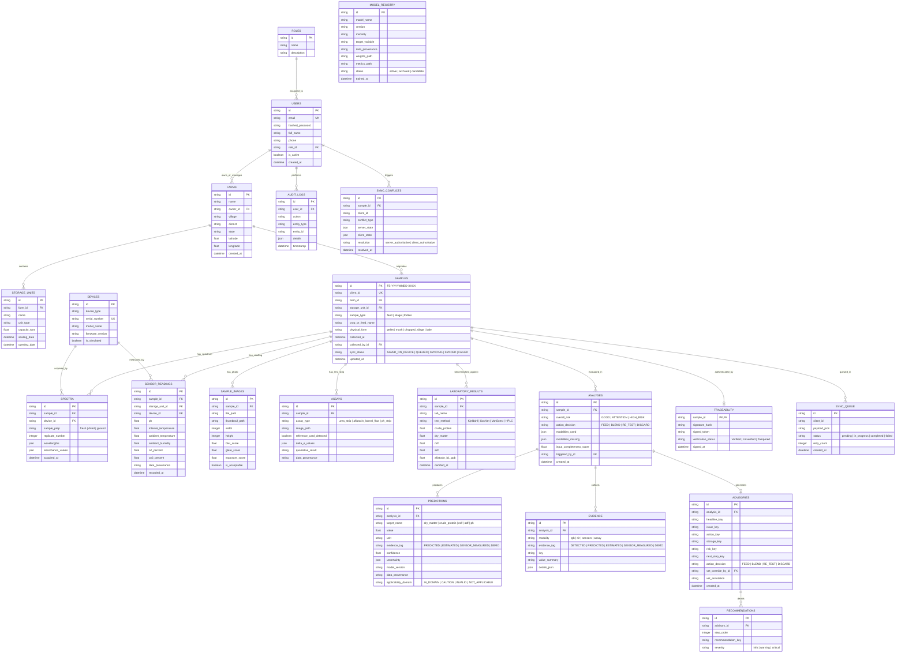

# FeedShield Database Schema & API Contract

This document provides the canonical specification for all relational tables, schema relationships, and API endpoints per **CLAUDE.md Section 0.9**.

---

## 1. Relational Database Schema (Mermaid ERD)



---

## 2. API Contract Specifications (`/api/v1`)

### Authentication & Authorization
* `POST /api/v1/auth/login`
  * Request: `{"email": "farmer@example.com", "password": "password123"}`
  * Response: `{"access_token": "...", "refresh_token": "...", "token_type": "bearer", "user": {"id": "...", "role": "farmer", "full_name": "..."}}`
* `GET /api/v1/auth/me`
  * Headers: `Authorization: Bearer <token>`
  * Response: User profile with permissions.

### Sample Ingestion & Analysis Orchestrator
* `POST /api/v1/samples`
  * Roles: `farmer`, `cooperative_manager`, `veterinarian`, `admin`
  * Request: Sample metadata (type, crop name, farm ID, collection date).
* `POST /api/v1/samples/{id}/image`
  * Multipart form file upload. Strips EXIF, checks Laplacian blur, stores thumbnail.
* `POST /api/v1/analyze`
  * Request:
    ```json
    {
      "sample_id": "FS-20260930-A101",
      "client_id": "client-uuid-1234",
      "image_id": "img-uuid",
      "spectrum_id": "spec-uuid",
      "sensor_data": {
        "ph": 4.1,
        "internal_temperature": 27.5,
        "ambient_temperature": 24.0,
        "crop_type": "maize_silage",
        "days_since_sealing": 45
      }
    }
    ```
  * Response (incorporating canonical prediction envelope):
    ```json
    {
      "analysis_id": "ana-uuid-99",
      "sample_id": "FS-20260930-A101",
      "overall_risk": "GOOD",
      "action_decision": "FEED",
      "input_completeness": {
        "score": 0.75,
        "modalities_used": ["rgb", "sensors"],
        "modalities_missing": ["nir", "assay"]
      },
      "predictions": [
        {
          "target": "ph",
          "value": 4.1,
          "unit": "pH",
          "evidence_tag": "SENSOR-MEASURED",
          "confidence": 0.95,
          "uncertainty": {"type": "interval", "lower": 4.0, "upper": 4.2, "level": 0.95},
          "model_version": "probe-cal-1.0",
          "data_provenance": "simulated_sensor",
          "modalities_used": ["sensors"],
          "modalities_missing": ["nir"],
          "applicability_domain": "IN_DOMAIN"
        }
      ],
      "silage_assessment": {
        "air_ingress_risk": "low",
        "heating_risk": "low",
        "spoilage_risk": "low",
        "fermentation_failure_risk": "low",
        "mould_risk": "low",
        "sensor_health_warning": "normal"
      },
      "advisory": {
        "headline": "Optimal Silage Fermentation",
        "chain": {
          "result": "Normal lactic acid preservation with stable internal temperature.",
          "issue": "None detected.",
          "action": "Proceed with planned daily feeding ration.",
          "storage": "Keep pit face cleanly cut; reseal plastic sheet tightly after feeding.",
          "risk": "Low spoilage hazard under current airtight management.",
          "next_step": "Re-check core temperature if pit remains open during rain."
        },
        "decision": "FEED"
      }
    }
    ```

### Public Traceability & Verification
* `GET /api/v1/verify/{sample_id}?token={signature_token}`
  * No authentication required.
  * Status returns:
    * `status: "Verified"` (Cryptographic signature valid, hash matched)
    * `status: "Unverified"` (Provisional offline scan, pending central sync)
    * `status: "Tampered"` (Signature invalid or record altered)
  * Returns sample ID, timestamp, model version, evidence tags, and provenance badge.

### Report Generation
* `POST /api/v1/reports/{analysis_id}/pdf`
  * Returns binary PDF stream branded with FeedShield, QR code, bilingual headings, and scientific disclaimers.
